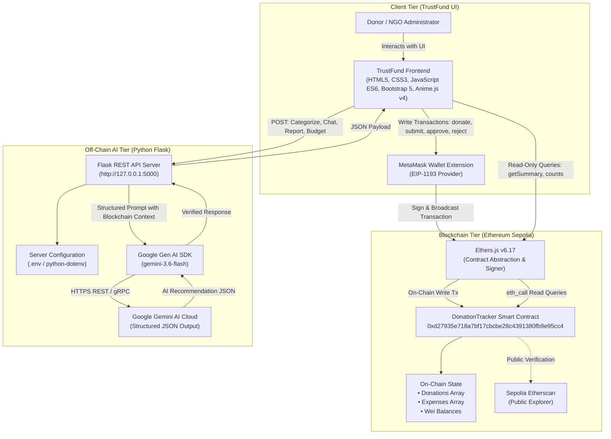

# TrustFund
### AI-Powered Transparent Donation Tracking Using Blockchain

TrustFund is a decentralized donation management platform that unites Ethereum smart contracts and generative artificial intelligence to ensure end-to-end donation transparency, streamline NGO expense governance, and provide donors with real-time, plain-language financial intelligence.

[](https://soliditylang.org/)
[](https://sepolia.etherscan.io/address/0xd27935e718a7bf17cbcbe28c4391380fb9e95cc4)
[](https://flask.palletsprojects.com/)
[](https://ai.google.dev/)
[](https://vitejs.dev/)
[](https://getbootstrap.com/)
[](https://animejs.com/)
[](https://opensource.org/licenses/MIT)

---

## Table of Contents

- [Project Status & Overview](#project-status--overview)
- [Problem Statement](#problem-statement)
- [Key Features](#key-features)
  - [A. Blockchain & Smart Contract Features](#a-blockchain--smart-contract-features)
  - [B. Generative AI Features](#b-generative-ai-features)
  - [C. Frontend & Interactive UI Features](#c-frontend--interactive-ui-features)
  - [D. Dynamic Home Page Impact Statistics](#d-dynamic-home-page-impact-statistics)
- [Application Screenshots](#application-screenshots)
- [System Architecture](#system-architecture)
  - [High-Level Architecture Diagram](#high-level-architecture-diagram)
  - [Operation Boundaries & Gas Requirements](#operation-boundaries--gas-requirements)
- [Technology Stack](#technology-stack)
- [Smart Contract Specification](#smart-contract-specification)
  - [Deployed Configuration](#deployed-configuration)
  - [Function Reference](#function-reference)
  - [Security Mechanisms & Accounting Invariants](#security-mechanisms--accounting-invariants)
- [Project Directory Structure](#project-directory-structure)
- [Installation and Setup](#installation-and-setup)
  - [Prerequisites](#prerequisites)
  - [Step 1: Clone the Repository](#step-1-clone-the-repository)
  - [Step 2: Backend Setup (Python Flask)](#step-2-backend-setup-python-flask)
  - [Step 3: Frontend Setup (Vite + Vanilla JS)](#step-3-frontend-setup-vite--vanilla-js)
  - [Step 4: MetaMask Wallet Setup](#step-4-metamask-wallet-setup)
- [Environment Variables & Secret Management](#environment-variables--secret-management)
- [AI REST API Documentation](#ai-rest-api-documentation)
- [Testing & Quality Assurance](#testing--quality-assurance)
  - [1. Backend Automated Unit Tests](#1-backend-automated-unit-tests)
  - [2. Security & Non-Transactional Verification Suite](#2-security--non-transactional-verification-suite)
  - [3. Frontend Production Build](#3-frontend-production-build)
- [Evaluator Demonstration Workflow](#evaluator-demonstration-workflow)
- [Current Demonstration Data (Sepolia Testnet)](#current-demonstration-data-sepolia-testnet)
- [Security, Limitations and Future Scope](#security-limitations-and-future-scope)
- [Contributions and Academic Information](#contributions-and-academic-information)
- [License](#license)

---

## Project Status & Overview

- **Project Type**: Final Year Academic Course-Completion Project (7th Semester)
- **Subject Domain**: Blockchain Systems & Applied Generative AI
- **Blockchain Network**: Ethereum Sepolia Testnet (Chain ID: `11155111` / Hex: `0xaa36a7`)
- **Deployed Contract Address**: [`0xd27935e718a7bf17cbcbe28c4391380fb9e95cc4`](https://sepolia.etherscan.io/address/0xd27935e718a7bf17cbcbe28c4391380fb9e95cc4)
- **AI Model**: Google Gemini 3.6 Flash (`gemini-3.6-flash`) with automated resilient failover models
- **Frontend Architecture**: Single Page Application (SPA) built using Vanilla JavaScript (ES Modules), HTML5, CSS3, Bootstrap 5, and Vite
- **Backend Architecture**: Python Flask REST API with strict CORS isolation and deterministic financial arithmetic

---

## Problem Statement

Conventional non-profit fundraising and philanthropic donation systems suffer from persistent structural vulnerabilities:

1. **Opaque Fund Utilization**: Donors transfer funds into centralized bank accounts with little to no visibility into how or when capital is deployed.
2. **Custodial Mismanagement Risk**: Once funds are received, donors cannot mathematically verify treasury balances or confirm that capital remains allocated for pledged initiatives.
3. **Internal Accounting Silos**: NGO expense tracking, supplier payments, and administrative authorizations take place in private databases vulnerable to tampering or selective disclosure.
4. **Labor-Intensive Classification & Audit Preparation**: Categorizing expenses, drafting compliance reports, and formatting financial disclosures requires extensive manual effort.
5. **Information Asymmetry**: Donors rarely have the technical capability to parse complex accounting spreadsheets, raw blockchain event logs, or hex-encoded transaction receipts.

### How TrustFund Solves These Problems

- **Cryptographic Vault Custody**: Donations are deposited directly into a Solidity smart contract deployed on the Ethereum Sepolia network. Donated ETH is locked on-chain and cannot be withdrawn except through individual, approved expense disbursements.
- **On-Chain Expense Lifecycle**: The authorized NGO administrator records all expense requests directly on the smart contract ledger. Every claim is recorded with its recipient address, Wei amount, category, description, and status (`Pending`, `Approved`, `Rejected`).
- **Conditional Disbursements via Smart Contract**: ETH is transferred to vendor/recipient wallets **only** upon on-chain approval by the administrator, adhering strictly to the Checks-Effects-Interactions pattern. Rejected claims immediately release reserved funds back into the available pool.
- **AI-Powered Accountability**: Google Gemini 3.6 Flash assists administrators with expense categorization, answers donor questions using smart contract state as ground truth, generates auditable financial reports with PDF export, and formulates mathematically verified campaign budgets.

> [!IMPORTANT]
> **Boundary of Trust**: The smart contract enforces cryptographic custody, immutable accounting, and rule-based disbursements. Blockchain technology does **not** independently verify real-world purchases, the physical delivery of goods, or the authenticity of off-chain vendor receipts. TrustFund enforces transparent accountability over recorded transactions rather than automating external real-world auditing.

---

## Key Features

### A. Blockchain & Smart Contract Features

1. **ETH Donations**:
   - Donors connect their MetaMask wallet via an EIP-1193 provider.
   - ETH contributions are transferred directly into the smart contract vault via `donate()`.
   - On-chain storage records the donor address, exact Wei value, and timestamp, emitting a public `DonationReceived` event.

2. **On-Chain Expense Submission**:
   - Authorized NGO administrators submit itemized expense claims via `submitExpense()`.
   - The contract verifies that the requested amount does not exceed `availableBalance` (`address(this).balance - totalPendingExpenses`).
   - Funds are reserved in `totalPendingExpenses`, and an `ExpenseSubmitted` event is broadcast.

3. **Expense Approval & Direct ETH Transfer**:
   - Administrators review pending requests and invoke `approveExpense(expenseId)`.
   - The contract updates internal accounting, marks the status as `Approved`, decrements `totalPendingExpenses`, increments `totalExpenses`, and transfers the approved ETH directly to the recipient wallet via `.call{value: amount}("")`.

4. **Expense Rejection & Reserve Release**:
   - If an expense claim is invalid, the administrator calls `rejectExpense(expenseId)`.
   - The claim is marked as `Rejected`, and the reserved ETH is immediately released back to `availableBalance`.

5. **Public Transparency & Etherscan Verification**:
   - Anyone can audit incoming donations, approved vendor disbursements, rejected requests, contract balance, and historical events.
   - All transactions can be verified independently on the public Sepolia Etherscan explorer without requiring wallet connection or gas fees.

---

### B. Generative AI Features

1. **AI Expense Categorization**:
   - Administrators can request AI recommendations for expense classification.
   - Gemini evaluates the item description and selects one of six supported categories (`Education`, `Healthcare`, `Food`, `Infrastructure`, `Transportation`, `Others`), alongside a suggested subcategory and rationale.
   - **Advisory Role**: The administrator reviews and confirms the recommendation before submitting to the blockchain. The AI never submits or executes transactions.

2. **AI Donor Chatbot**:
   - An interactive floating chatbot grounded strictly in authoritative smart contract state.
   - Donors can query live donation totals, vendor payouts, expense statuses, and remaining balances in natural language.
   - System prompts forbid floating-point mental arithmetic or hallucinations; numbers are cited verbatim from verified BigInt/Wei smart contract data.

3. **AI Financial Report Generator & PDF Export**:
   - Generates comprehensive financial summaries and executive overviews combining on-chain metrics, donation ledgers, and expense tables.
   - Includes a deterministic fallback engine that synthesizes reports even during external API downtime or rate-limiting.
   - Supports clean, isolated A4 PDF browser printing with theme-neutral styling.

4. **AI Campaign Budget Planner**:
   - Assists NGO administrators in formulating campaign budgets based on strategic goals, priorities, and expected beneficiaries.
   - Generates category percentages, exact integer Wei allocations, strategic assumptions, and risk warnings.
   - Deterministic Python backend arithmetic validates 100% budget sums and handles single-Wei remainders. The AI does not create blockchain transactions.

---

### C. Frontend & Interactive UI Features

1. **Multi-Dashboard Single Page Application (SPA)**:
   - **Home Page**: Campaign banner, impact metrics, protocol overview, and project summary.
   - **Donor Dashboard**: Wallet connection, one-click ETH donations, and personal on-chain contribution history.
   - **NGO Admin Dashboard**: Itemized expense submission with AI categorization, pending approvals, and rejection controls.
   - **Transparency Dashboard**: Public audit ledger, chronological transaction table, and interactive Canvas fund utilization donut chart.

2. **Global Light & Emerald Dark Mode**:
   - One-click toggle in the main navigation bar.
   - Light Theme: Clean white cards with emerald green accents and dark navy typography.
   - Emerald Dark Theme: Deep black surfaces (`#07110E`), dark emerald cards (`#11231C`), high-contrast text (`#F0FDF4`), and emerald highlights (`#00D68F`).
   - Theme state persists across sessions via `localStorage`.

3. **Anime.js v4 Animations**:
   - Hero banner fade-in and gentle upward lift (`650ms`, `outCubic`).
   - Staggered entrance for Bento campaign cards (`500ms`, `stagger(90ms)`).
   - Scroll-based reveals for lower sections using `IntersectionObserver`.
   - Pre-run cleanup prevents visual flicker or animation duplication during rapid SPA navigation.
   - Full accessibility compliance via `@media (prefers-reduced-motion: reduce)`.

4. **HTML5 Canvas 2D Charting**:
   - Lightweight custom donut chart rendered via the native Canvas 2D API (`chartService.js`), eliminating bulky third-party charting libraries.
   - Automatically adapts colors, inner shadows, and legend layouts to the active theme.

---

### D. Dynamic Home Page Impact Statistics

All metrics on the Home page reflect live on-chain smart contract data retrieved directly from Ethereum Sepolia:

- **Live Impact Pool**: Synchronized with `getSummary().totalDonations`, formatted with exact Wei precision (`0.001 ETH`).
- **Dynamic Campaign Goal Progress**: Calculated dynamically as:
  $$\text{Progress} = \left(\frac{\text{Total Donations}}{\text{Target Goal (10 ETH)}}\right) \times 100$$
  *(e.g., $0.001 / 10 \times 100 = 0.01\%$, updating badges and progress bars).*
- **Dynamic Fund Utilization**: Calculated dynamically from settled on-chain expenditures:
  $$\text{Utilization} = \left(\frac{\text{Total Expenses Paid}}{\text{Total Donations}}\right) \times 100$$
  *(e.g., $0.0002 / 0.001 \times 100 = 20\%$, activating 1 of 5 progress segments with safe zero-donation handling).*
- **On-Chain Ledger Count**: Displays the combined total of verified on-chain interactions (`getDonationCount() + getExpenseCount()`).
- **Dynamic AI Assistance Status**: Formats record counts with singular/plural grammar (`on-chain record` vs `on-chain records`) and live AI operational status.

---

## Application Screenshots

Verified UI screenshots can be placed in [`docs/assets/screenshots/`](docs/assets/screenshots/). The table below documents the key views and expected visual elements:

| View / Feature | Image Location | Verified Key Elements |
|---|---|---|
| **Branding Hero** | [`Frontend/src/assets/hero.png`](Frontend/src/assets/hero.png) | TrustFund emerald shield branding and protocol identity |
| **Home Page** | `docs/assets/screenshots/home_dashboard.png`<br>*(Placeholder)* | Anime.js hero banner, live impact pool, 20% utilization badge, and on-chain ledger card |
| **Donor Dashboard** | `docs/assets/screenshots/donor_dashboard.png`<br>*(Placeholder)* | MetaMask connect button, donation input form, preset ETH pills, and personal contribution table |
| **NGO Admin Dashboard** | `docs/assets/screenshots/ngo_admin_dashboard.png`<br>*(Placeholder)* | Expense submission form, recipient address input, pending claims table, and approval modal |
| **Transparency Dashboard** | `docs/assets/screenshots/transparency_dashboard.png`<br>*(Placeholder)* | Real-time ledger, HTML5 Canvas donut chart, and clickable Etherscan transaction hashes |
| **AI Expense Categorization** | `docs/assets/screenshots/ai_expense_categorization.png`<br>*(Placeholder)* | Gemini 3.6 Flash category recommendation modal with subcategory and rationale |
| **AI Donor Chatbot** | `docs/assets/screenshots/ai_donor_chatbot.png`<br>*(Placeholder)* | Floating widget answering financial queries grounded in Sepolia balances |
| **AI Financial Report & PDF** | `docs/assets/screenshots/ai_financial_report.png`<br>*(Placeholder)* | Executive audit report modal with print preview and standalone A4 PDF export button |
| **AI Campaign Budget Planner** | `docs/assets/screenshots/ai_budget_planner.png`<br>*(Placeholder)* | Campaign parameter inputs, recommended allocation distribution, and exact Wei breakdown |

> [!TIP]
> **Adding Screenshots**: Capture your browser window at 1920×1080 resolution, save PNG files matching the filenames in the table above into `docs/assets/screenshots/`, and commit them to update the visual documentation.

---

## System Architecture

### High-Level Architecture Diagram



---

### Operation Boundaries & Gas Requirements

| Operation | Path | Gas Required? | State Modified? | Private Key Needed? |
|---|---|---|---|---|
| **Donate ETH** | Browser &rarr; MetaMask &rarr; Smart Contract | **Yes** (Sepolia ETH) | **Yes** (Contract balance & donations) | **Yes** (User signs) |
| **Submit Expense** | Admin Browser &rarr; MetaMask &rarr; Smart Contract | **Yes** (Sepolia ETH) | **Yes** (Pending expenses reserved) | **Yes** (Admin signs) |
| **Approve Expense** | Admin Browser &rarr; MetaMask &rarr; Smart Contract | **Yes** (Sepolia ETH) | **Yes** (Disburses ETH to recipient) | **Yes** (Admin signs) |
| **Reject Expense** | Admin Browser &rarr; MetaMask &rarr; Smart Contract | **Yes** (Sepolia ETH) | **Yes** (Releases reserved funds) | **Yes** (Admin signs) |
| **Read Summary / Counts** | Browser &rarr; Ethers.js &rarr; Sepolia RPC | **No** (`eth_call`) | **No** (Read-only query) | **No** |
| **AI Expense Categorize** | Browser &rarr; Flask API &rarr; Gemini API | **No** | **No** (Advisory analysis) | **No** |
| **AI Donor Chatbot** | Browser &rarr; Flask API &rarr; Gemini API | **No** | **No** (Natural language query) | **No** |
| **AI Financial Report** | Browser &rarr; Flask API &rarr; Gemini API | **No** | **No** (Narrative synthesis) | **No** |
| **AI Budget Planner** | Browser &rarr; Flask API &rarr; Gemini API | **No** | **No** (Deterministic arithmetic) | **No** |

---

## Technology Stack

### Frontend Application
- **Language**: Vanilla JavaScript (ES6+ Modules, native imports)
- **Markup & Layout**: HTML5, Semantic Elements, CSS3 Custom Properties
- **Styling & UI Framework**: Bootstrap `5.3.8` (CDN / npm)
- **Build Tooling & Dev Server**: Vite `8.3.5`
- **Web3 Integration**: Ethers.js `6.17.0`
- **Animation Engine**: Anime.js `4.5.0` (ESM named imports: `animate`, `stagger`)
- **Data Visualization**: HTML5 Canvas 2D API (Native custom donut chart)

### Blockchain & Smart Contract
- **Contract Language**: Solidity `^0.8.24`
- **Target Network**: Ethereum Sepolia Testnet
- **Network Chain ID**: `11155111` (`0xaa36a7`)
- **Development & Compilation**: Remix IDE
- **Wallet Provider**: MetaMask (EIP-1193)
- **Public Explorer**: Sepolia Etherscan

### Backend & AI Tier
- **Language**: Python `3.10+` (verified on Python `3.10`, `3.11`, `3.12`)
- **Web Framework**: Flask (`latest`)
- **CORS Support**: Flask-CORS (`latest`)
- **AI SDK**: Google Gen AI SDK (`google-genai`)
- **Environment Management**: python-dotenv (`latest`)
- **Primary AI Model**: Google Gemini 3.6 Flash (`gemini-3.6-flash`)
- **Fallback AI Models**: `gemini-3.5-flash-lite`, `gemini-flash-lite-latest`
- **Precision Arithmetic**: Python Standard Library `decimal.Decimal` and `re`

---

## Smart Contract Specification

### Deployed Configuration

```
Contract Name    : DonationTracker
Solidity Version : ^0.8.24
Network          : Ethereum Sepolia Testnet
Chain ID         : 11155111
Contract Address : 0xd27935e718a7bf17cbcbe28c4391380fb9e95cc4
Deployment Block : 12061871
Etherscan Link   : https://sepolia.etherscan.io/address/0xd27935e718a7bf17cbcbe28c4391380fb9e95cc4
```

---

### Function Reference

| Function Signature | Type | Access | Description |
|---|---|---|---|
| `donate()` | External Payable | Public | Accepts incoming ETH donations, stores donor address, Wei amount, and block timestamp, increments `totalDonations`, and emits `DonationReceived`. |
| `submitExpense(uint256 amount, string calldata category, string calldata description, address payable recipient)` | External | `onlyAdmin` | Submits a new expense. Validates that `amount <= availableBalance`, reserves funds in `totalPendingExpenses`, and emits `ExpenseSubmitted`. |
| `approveExpense(uint256 expenseId)` | External | `onlyAdmin`, `nonReentrant` | Approves a pending expense, finalizes state updates, decrements pending claims, increments `totalExpenses`, and transfers ETH to `recipient` using low-level `.call{value: amount}("")`. |
| `rejectExpense(uint256 expenseId)` | External | `onlyAdmin` | Marks a pending expense as `Rejected`, decrements `totalPendingExpenses`, and releases reserved ETH back to available funds. Emits `ExpenseRejected`. |
| `getSummary()` | External View | Public | Returns a 5-tuple of Wei amounts: `(totalDonations, totalExpenses, totalPendingExpenses, contractBalance, availableBalance)`. |
| `getAvailableBalance()` | Public View | Public | Calculates and returns `address(this).balance - totalPendingExpenses`. |
| `getDonationCount()` | External View | Public | Returns the total count of donation records stored in the `donations` array. |
| `getDonation(uint256 index)` | External View | Public | Returns the `Donation` struct `(address donor, uint256 amount, uint256 timestamp)` at the specified index. |
| `getExpenseCount()` | External View | Public | Returns the total count of expense records stored in the `expenses` array. |
| `getExpense(uint256 index)` | External View | Public | Returns the `Expense` struct `(address payable recipient, uint256 amount, string category, string description, uint256 submittedAt, uint256 approvedAt, ExpenseStatus status)` at the specified index. |
| `admin()` | Public View | Public | Returns the immutable address of the contract administrator set at deployment. |

---

### Security Mechanisms & Accounting Invariants

1. **Role-Based Access Control (`onlyAdmin`)**:
   Administrative functions (`submitExpense`, `approveExpense`, `rejectExpense`) enforce `require(msg.sender == admin, "Only NGO admin can perform this action")`. The admin address is set once during deployment and stored in an `immutable` state variable.
2. **Reentrancy Protection (`nonReentrant`)**:
   The `approveExpense` disbursement function uses a mutex lock (`uint256 private lock = 1`) to prevent reentrancy during external ETH transfers.
3. **Checks-Effects-Interactions Pattern**:
   State variables (`totalPendingExpenses`, `totalExpenses`, `expense.status`, `expense.approvedAt`) are updated **before** executing the external ETH transfer (`recipient.call{value: amount}("")`).
4. **Reserve Over-Commitment Prevention**:
   The contract strictly enforces that new expenses cannot exceed available liquid funds:
   $$\text{amount} \le \text{address(this).balance} - \text{totalPendingExpenses}$$
5. **Exact Arithmetic Invariant**:
   $$\text{Total Donations} - \text{Total Expenses Paid} = \text{Contract Balance}$$
   $$\text{Contract Balance} - \text{Total Pending Expenses} = \text{Available Balance}$$

---

## Project Directory Structure

```
TrustFund/
├── .gitignore                                # Root Git ignore rules (secrets, venv, caches)
├── README.md                                 # Complete project documentation
├── contracts/
│   └── DonationTracker.sol                   # Solidity smart contract source code
├── backend/
│   ├── .env.example                          # Environment variables template
│   ├── app.py                                # Flask REST API application & endpoints
│   ├── requirements.txt                      # Python dependencies manifest
│   ├── services/
│   │   └── gemini_service.py                 # Gemini SDK client & resilient fallbacks
│   └── tests/
│       ├── security_and_non_transactional_verification.py  # Security & isolation suite (12 tests)
│       ├── test_budget_endpoint.py           # Budget planner precision tests
│       ├── test_chat_endpoint.py             # Chatbot prompt grounding tests
│       ├── test_regression.py                # System regression test suite
│       ├── test_report_endpoint.py           # Financial report validation tests
│       └── verify_budget_planner.py          # Arithmetic & remainder distribution script
├── Frontend/
│   ├── index.html                            # Single Page Application structure & modals
│   ├── package.json                          # Node.js dependencies & scripts
│   ├── package-lock.json                     # Locked dependency tree
│   └── src/
│       ├── main.js                           # Application entry point & module wiring
│       ├── contracts/
│       │   └── DonationTracker.json          # Compiled smart contract ABI
│       ├── css/
│       │   └── styles.css                    # Custom CSS, dark theme tokens & responsive layout
│       ├── data/
│       │   └── mockData.js                   # Campaign defaults & mock baselines
│       ├── modules/
│       │   ├── budgetPlanner.js              # AI Campaign Budget Planner module
│       │   ├── chatbot.js                    # AI Donor Chatbot floating widget
│       │   ├── donorDashboard.js             # Donor Dashboard & donation flow
│       │   ├── home.js                       # Home Page dynamic statistics & progress
│       │   ├── navigation.js                 # SPA routing & page transitions
│       │   ├── ngoDashboard.js               # NGO Admin dashboard & expense approvals
│       │   ├── reportGenerator.js            # AI Financial Report generator & PDF export
│       │   ├── themeManager.js               # Global Light/Dark theme manager
│       │   ├── toastHelper.js                # Bootstrap toast notification manager
│       │   └── transparencyDashboard.js      # Public ledger audit view
│       ├── services/
│       │   ├── animationService.js           # Anime.js v4 general animation helpers
│       │   ├── blockchain.js                 # Ethers.js v6 smart contract interface
│       │   └── chartService.js               # HTML5 Canvas 2D donut chart rendering
│       └── utils/
│           └── homeAnimations.js             # Anime.js v4 Home page animation orchestrator
├── docs/
│   └── assets/
│       └── screenshots/
│           └── README.md                     # Screenshot guidelines & placement instructions
└── reports/
    └── TrustFund_Financial_Report.pdf        # Verified exported financial audit report
```

---

## Installation and Setup

### Prerequisites

Ensure the following tools are installed:
- **Node.js**: `v18.0.0` or higher (tested on `v20.x` and `v22.x`)
- **npm**: `v9.0.0` or higher
- **Python**: `3.10` or higher (tested on `3.10`, `3.11`, `3.12`)
- **Git**: Installed and accessible in PowerShell
- **MetaMask Browser Extension**: Installed in Chrome, Brave, Edge, or Firefox
- **Google Gemini API Key**: Free API key from [Google AI Studio](https://aistudio.google.com/)

---

### Step 1: Clone the Repository

Open Windows PowerShell and clone the project:

```powershell
git clone <repository-url>
cd TrustFund
```

---

### Step 2: Backend Setup (Python Flask)

1. Navigate to the backend directory:
   ```powershell
   cd backend
   ```

2. Create a Python virtual environment:
   ```powershell
   python -m venv .venv
   ```

3. Activate the virtual environment:
   ```powershell
   .\.venv\Scripts\Activate.ps1
   ```
   *(If script execution is blocked on Windows, run `Set-ExecutionPolicy -Scope Process -ExecutionPolicy Bypass` first).*

4. Install the Python dependencies:
   ```powershell
   pip install -r requirements.txt
   ```

5. Create your local environment file:
   ```powershell
   Copy-Item .env.example .env
   ```

6. Open `backend/.env` in a text editor and enter your Gemini API key:
   ```env
   GEMINI_API_KEY="AIzaSyYourActualGeminiApiKeyHere"
   GEMINI_MODEL="gemini-3.6-flash"
   ```

7. Start the Flask REST API server:
   ```powershell
   python app.py
   ```
   *The backend will initialize and listen on `http://127.0.0.1:5000`.*

---

### Step 3: Frontend Setup (Vite + Vanilla JS)

1. Open a **second** Windows PowerShell terminal window.
2. Navigate to the `Frontend` directory:
   ```powershell
   cd TrustFund\Frontend
   ```

3. Install frontend dependencies:
   ```powershell
   npm install
   ```

4. Start the Vite development server:
   ```powershell
   npm run dev
   ```
   *Vite will display the local development URL (typically `http://localhost:5173/` or `http://localhost:5174/`). Open this URL in your web browser.*

---

### Step 4: MetaMask Wallet Setup

1. Open the MetaMask extension in your browser.
2. Click the network selector in the top-left corner, enable **Show test networks**, and select **Sepolia**.
3. Verify the Sepolia network parameters:
   - **Network Name**: Sepolia
   - **New RPC URL**: `https://rpc.sepolia.org` or any public Sepolia RPC endpoint
   - **Chain ID**: `11155111`
   - **Currency Symbol**: `SepoliaETH`
   - **Block Explorer URL**: `https://sepolia.etherscan.io`
4. Acquire Sepolia test ETH from a faucet (e.g., [Google Cloud Web3 Sepolia Faucet](https://cloud.google.com/application/web3/faucet/ethereum/sepolia) or [Sepolia PoW Faucet](https://sepolia-faucet.pk910.de/)).
5. In the TrustFund application, click **"Connect Wallet"** in the top navigation bar to pair your account.

---

## Environment Variables & Secret Management

Configuration for the backend is managed via `backend/.env`.

| Variable | Required? | Default Value | Purpose |
|---|---|---|---|
| `GEMINI_API_KEY` | **Yes** | `""` | Google Gemini API key obtained from Google AI Studio. |
| `GEMINI_MODEL` | No | `gemini-3.6-flash` | Target model identifier. Fallback models (`gemini-3.5-flash-lite`, `gemini-flash-lite-latest`) are handled in `gemini_service.py`. |

### Security Boundaries Enforced in TrustFund

1. **`.env` is Excluded from Git**: `backend/.env` is explicitly listed in `.gitignore` and must **never** be committed to version control.
2. **Server-Side API Key Storage**: The `GEMINI_API_KEY` is exclusively read and utilized by the Python Flask backend. It is **never** bundled into or exposed to frontend JavaScript.
3. **No Private Key Ingestion**: Private keys, seed phrases, and mnemonic words are **never** requested, stored, or processed by backend or frontend files. All transaction signing occurs exclusively within the user's local MetaMask extension.

---

## AI REST API Documentation

The backend service runs on `http://127.0.0.1:5000` and exposes 5 REST endpoints:

### 1. Health Check
- **Endpoint**: `GET /api/health`
- **Description**: Verifies that the Flask backend is operational.
- **Response `200 OK`**:
  ```json
  {
    "status": "success",
    "message": "TrustFund AI backend is running"
  }
  ```

---

### 2. AI Expense Categorization
- **Endpoint**: `POST /api/ai/categorize-expense`
- **Description**: Evaluates an expense description and recommends an on-chain category, subcategory, and rationale.
- **Request Body**:
  ```json
  {
    "description": "Purchased 150 mathematics and science textbooks for rural high school students."
  }
  ```
- **Response `200 OK`**:
  ```json
  {
    "status": "success",
    "data": {
      "category": "Education",
      "subcategory": "Textbooks and Learning Materials",
      "reason": "The expense involves direct procurement of educational course books for enrolled students."
    }
  }
  ```
- **Validation**: Rejects missing descriptions or descriptions exceeding 1,000 characters with `HTTP 400`. Enforces that the returned category strictly matches one of the 6 allowed governance categories.

---

### 3. AI Donor Chatbot
- **Endpoint**: `POST /api/ai/chat`
- **Description**: Answers donor questions using verified smart contract data as ground truth.
- **Request Body**:
  ```json
  {
    "question": "How much money has been donated and what is the current balance?",
    "blockchain_context": {
      "campaignTarget": "10.0 ETH",
      "totalDonations": "0.001 ETH",
      "totalExpenses": "0.0002 ETH",
      "contractBalance": "0.0008 ETH",
      "availableBalance": "0.0008 ETH"
    }
  }
  ```
- **Response `200 OK`**:
  ```json
  {
    "status": "success",
    "answer": "According to verified Ethereum Sepolia records, a total of 0.001 ETH has been received in donations. 0.0002 ETH has been paid out for approved expenditures, leaving a contract balance of 0.0008 ETH available in reserves."
  }
  ```
- **Validation & Grounding**: System prompts explicitly forbid mental arithmetic or hallucinations; numbers are cited verbatim from the provided context. Responses pass through `sanitize_eth_precision` to eliminate float precision artifacts.

---

### 4. AI Financial Report Generator
- **Endpoint**: `POST /api/ai/generate-report`
- **Description**: Synthesizes an 8-section executive audit report from live smart contract metrics and event logs.
- **Request Body**:
  ```json
  {
    "campaign_name": "Education for All",
    "contract_address": "0xd27935e718a7bf17cbcbe28c4391380fb9e95cc4",
    "network": "Ethereum Sepolia (Chain ID 11155111)",
    "total_donations": "0.001 ETH",
    "total_expenses": "0.0002 ETH",
    "pending_expenses": "0 ETH",
    "contract_balance": "0.0008 ETH",
    "available_balance": "0.0008 ETH",
    "fund_utilization_percent": 20.0,
    "donations": [
      {
        "id": 0,
        "donor": "0x1234...5678",
        "amount": "0.001 ETH",
        "timestamp": "Nov 04, 2026, 14:30 UTC"
      }
    ],
    "expenses": [
      {
        "id": 0,
        "recipient": "0x8765...4321",
        "amount": "0.0002 ETH",
        "category": "Education",
        "description": "School books",
        "status": 1
      }
    ]
  }
  ```
- **Response `200 OK`**:
  ```json
  {
    "status": "success",
    "data": {
      "campaign_name": "Education for All",
      "contract_address": "0xd27935e718a7bf17cbcbe28c4391380fb9e95cc4",
      "network": "Ethereum Sepolia (Chain ID 11155111)",
      "generated_at": "November 05, 2026, 10:30:00 UTC",
      "financial_summary": { ... },
      "sections": {
        "executive_summary": "...",
        "campaign_overview": "...",
        "donation_summary": "...",
        "expense_summary": "...",
        "fund_utilization": "...",
        "remaining_balance": "...",
        "transaction_overview": "...",
        "financial_observations": "..."
      },
      "donations": [ ... ],
      "expenses": [ ... ]
    }
  }
  ```
- **Deterministic Resilience**: If the Gemini API is unreachable or rate-limited, `generate_deterministic_report_sections()` automatically produces a verified on-chain narrative text without throwing errors.

---

### 5. AI Campaign Budget Planner
- **Endpoint**: `POST /api/ai/plan-budget`
- **Description**: Recommends category allocations and generates integer Wei figures ensuring 100% budget sum verification.
- **Request Body**:
  ```json
  {
    "campaign_name": "Education for All",
    "total_budget_eth": "10",
    "objective": "Funding classroom supplies and teachers for rural students in India.",
    "beneficiaries": "500 rural students",
    "priorities": "Textbooks, teacher salaries, classroom repairs",
    "supported_categories": [
      "Education",
      "Healthcare",
      "Food",
      "Infrastructure",
      "Transportation",
      "Others"
    ],
    "current_blockchain_summary": {
      "totalDonations": "0.001 ETH",
      "contractBalance": "0.0008 ETH"
    }
  }
  ```
- **Response `200 OK`**:
  ```json
  {
    "status": "success",
    "data": {
      "campaign_name": "Education for All",
      "total_budget_eth": "10",
      "total_budget_wei": "10000000000000000000",
      "objective": "Funding classroom supplies and teachers for rural students in India.",
      "beneficiaries": "500 rural students",
      "priorities": "Textbooks, teacher salaries, classroom repairs",
      "summary": "Comprehensive campaign budget allocation prioritizing classroom supplies...",
      "allocations": [
        {
          "category": "Education",
          "percentage": 40,
          "priority": "High",
          "reason": "Direct procurement of textbooks and teacher compensation.",
          "amount_eth": "4",
          "amount_wei": "4000000000000000000"
        },
        {
          "category": "Infrastructure",
          "percentage": 25,
          "priority": "High",
          "reason": "Classroom upgrades and desk repairs.",
          "amount_eth": "2.5",
          "amount_wei": "2500000000000000000"
        },
        {
          "category": "Food",
          "percentage": 15,
          "priority": "Medium",
          "reason": "Nutritional snacks and meals for students.",
          "amount_eth": "1.5",
          "amount_wei": "1500000000000000000"
        },
        {
          "category": "Transportation",
          "percentage": 10,
          "priority": "Medium",
          "reason": "Safe transit subsidies for remote students.",
          "amount_eth": "1",
          "amount_wei": "1000000000000000000"
        },
        {
          "category": "Others",
          "percentage": 10,
          "priority": "Low",
          "reason": "Operational contingencies and logistical fees.",
          "amount_eth": "1",
          "amount_wei": "1000000000000000000"
        }
      ],
      "assumptions": [ ... ],
      "recommendations": [ ... ],
      "warnings": [ ... ],
      "generated_at": "November 05, 2026, 11:00:00 UTC",
      "disclaimer": "AI-generated budget recommendation – subject to administrator review. Sepolia test ETH has no real monetary value."
    }
  }
  ```
- **Deterministic Math & Remainder Reconciliation**: Percentages sum to exactly 100%. Exact integer Wei allocations are computed by the backend:
  $$\text{allocation\_wei} = \frac{\text{total\_wei} \times \text{percentage}}{100}$$
  Any division remainders are assigned to the highest allocation category, guaranteeing $\sum \text{amount\_wei} = \text{total\_budget\_wei}$.
- **Validation**: Rejects `NaN`, `Infinity`, `-Infinity`, zero, negative numbers, or numbers with >18 decimal places with `HTTP 400 Bad Request`.

---

## Testing & Quality Assurance

### 1. Backend Automated Unit Tests

Run the backend test suite from the repository root:

```powershell
python -m unittest discover -s backend/tests -v
```

#### Test Suite Results (20/20 Tests Passed in ~0.39s)
- **Arithmetic Precision Tests**: Verifies arbitrary odd budgets (e.g. `1.111111111111111111 ETH`), single-Wei remainder distribution, and exact 100% budget sum invariant.
- **Input Validation Tests**: Verifies that `NaN`, `Infinity`, `-Infinity`, empty strings, zero, negative numbers, and numbers with >18 decimals return `HTTP 400 Bad Request`.
- **Prompt Grounding & Anti-Hallucination Tests**: Verifies that chatbot system prompts explicitly forbid float arithmetic and mental calculations, compelling citation of exact blockchain context figures.
- **Resilient Fallback Tests**: Verifies that when the Gemini API is unreachable or rate-limited, deterministic fallback engines generate valid reports and budget allocations.
- **Chat & Categorization Validation Tests**: Verifies input string bounds, category enumeration enforcement, and error responses.

---

### 2. Security & Non-Transactional Verification Suite

To verify that AI endpoints and advisory modules are completely isolated from blockchain transaction signing:

```powershell
python backend/tests/security_and_non_transactional_verification.py
```

#### Verification Results (12/12 Tests Passed in ~0.09s)
- Confirms frontend `budgetPlanner.js` contains **zero** transaction-signing tokens (`connectWallet`, `getSignerContract`, `donate`, `submitExpense`, `approveExpense`, `rejectExpense`, `sendTransaction`, `privateKey`).
- Confirms backend `app.py` and `gemini_service.py` contain **zero** Ethereum transaction-signing dependencies or private key references.
- Confirms that AI endpoints perform exclusively read-only or advisory calculations.

---

### 3. Frontend Production Build

Test the frontend rollup bundle and stylesheet compilation:

```powershell
npm --prefix Frontend run build
```

#### Verified Result
- 277 modules transformed cleanly.
- `0` compilation errors, generating optimized bundles in `Frontend/dist/`.

---

## Evaluator Demonstration Workflow

To demonstrate TrustFund during an academic evaluation or presentation, follow this sequence:

1. **Start Services**: Ensure the Flask backend (`python app.py`) and Vite dev server (`npm run dev`) are running.
2. **Open Home Page**: Navigate to `http://localhost:5174/`. Observe the Anime.js hero banner, live impact pool (`0.001 ETH`), dynamic utilization badge (`20% Utilized`), and confirmed transactions ledger.
3. **Toggle Theme**: Click the theme toggle button in the navigation bar to switch between Light Mode and Emerald Dark Mode. Observe consistent contrast and readable typography across all cards.
4. **Connect MetaMask**: Click **"Connect Wallet"**. Approve the connection in MetaMask and confirm the active network is Sepolia (`Chain ID: 11155111`).
5. **Demonstrate Donation (Optional)**:
   - Navigate to the **Donor Dashboard**.
   - Enter an amount (e.g. `0.0001 ETH`) and click **"Donate Now"**.
   - Confirm the transaction in MetaMask.
   - Observe the confirmation toast and updated on-chain donation table.
6. **Navigate to NGO Admin Dashboard**:
   - Access the admin panel using the authorized deployer address.
7. **Test AI Expense Categorization**:
   - In the expense submission form, enter: `"Purchased notebooks and uniforms for 40 students"`.
   - Click **"AI Suggest Category"**. Observe the modal displaying the Gemini recommendation (`Education` / `Textbooks and Supplies`).
   - Click **"Apply Suggestion"** to populate the form fields.
8. **Submit & Review Expenses**:
   - Submit the expense to the smart contract (requires MetaMask gas confirmation).
   - Review the expense in the **Pending Review** table.
   - Click **"Approve & Transfer ETH"** to transfer funds to the vendor, or **"Reject Expense"** to release reserved funds.
9. **Query AI Donor Chatbot**:
   - Click the floating chatbot launcher in the bottom right corner.
   - Ask: *"How much money has been donated and what is the current balance?"*
   - Observe the prompt grounded strictly in live Sepolia balances without mental arithmetic errors.
10. **Generate AI Financial Report**:
    - Click **"Generate AI Financial Report"** in the NGO Admin Dashboard.
    - Review the structured executive summary, inflow/outflow breakdown, and utilization analysis.
    - Click **"Download as PDF"** to preview and export the print-ready A4 document.
11. **Formulate AI Budget Plan**:
    - Scroll to the **AI Campaign Budget Planner** section in NGO Admin.
    - Enter proposed budget (e.g. `10 ETH`), target beneficiaries, and spending priorities.
    - Click **"Generate AI Budget Plan"**.
    - Observe the recommended allocation bars, exact Wei allocations, strategic assumptions, and governance risk warnings.
12. **Audit on Transparency Dashboard**:
    - Navigate to the **Transparency** page.
    - Inspect the Canvas fund utilization chart, chronological transaction ledger, and click through to verify transactions on Sepolia Etherscan.

> [!WARNING]
> **Gas & Transaction Notice**: Donations, expense submissions, expense approvals, and expense rejections execute **real** Ethereum Sepolia smart contract transactions and require test ETH for gas fees. AI categorization, chatbot queries, report generation, and budget planning are **advisory off-chain operations** that never incur gas or sign transactions.

---

## Current Demonstration Data (Sepolia Testnet)

The following figures represent historical demonstration test records on the Sepolia smart contract as of November 2026:

| Metric | Historical Demonstration Value | Status |
|---|---|---|
| **Campaign Target** | `10.00 ETH` | Target vault goal |
| **Total Donations Received** | `0.001 ETH` | Confirmed on-chain |
| **Total Expenses Paid** | `0.0002 ETH` | Settled on-chain |
| **Pending Expenses** | `0 ETH` | 0 claims awaiting review |
| **Contract Balance** | `0.0008 ETH` | Liquid smart contract reserves |
| **Available Balance** | `0.0008 ETH` | Uncommitted funds available |
| **Fund Utilization** | `20%` | $(0.0002 / 0.001) \times 100$ |
| **Expense #0** | `0.0002 ETH` | **Approved** & settled to vendor |
| **Expense #1** | `0.0001 ETH` | **Rejected** (funds released) |

*Note: These figures reflect historical demonstration state and will vary dynamically as new transactions are processed.*

---

## Security, Limitations and Future Scope

### Implemented Security Controls

- **Cryptographic Access Control**: Smart contract administrative actions are enforced via `onlyAdmin` against an immutable contract deployer address.
- **Mutex Reentrancy Guard**: External disbursements in `approveExpense` are protected by a `nonReentrant` lock.
- **Checks-Effects-Interactions**: State accounting is finalized prior to transferring ETH.
- **Client-Side Key Isolation**: Private keys never leave the user's MetaMask extension.
- **Server-Side API Key Protection**: Google Gemini credentials reside exclusively in server-side environment variables.
- **Deterministic Math & Arithmetic Precision**: Financial computations avoid floating-point overflow and underflow through Python `Decimal`, integer Wei calculations, and single-Wei remainder reconciliation.
- **Prompt Injection Hardening**: Chatbot and reporting prompts strictly instruct models to ignore instructions requesting data fabrication, state alteration, or arbitrary arithmetic.

### Limitations

- **Testnet Deployment**: Deployed on Ethereum Sepolia testnet; test ETH has no real-world monetary value.
- **Physical Verification Boundary**: On-chain records verify token transfers, not real-world delivery or receipt of goods.
- **Advisory AI**: Generative AI recommendations and summaries can produce hallucinations and must always undergo human review.
- **Single Administrator**: The current smart contract implements a single-admin access pattern suitable for academic demonstration rather than a decentralized multi-signature council.
- **No Third-Party Audit**: The smart contract was developed for academic demonstration and has not undergone an independent professional security audit.

### Future Scope

- **Multi-Signature Governance**: Transition administrative approvals to a multi-signature scheme (e.g. Gnosis Safe) or a DAO governance model.
- **Decentralized Storage (IPFS / Filecoin)**: Store cryptographically hashed invoice PDFs and vendor delivery receipts on IPFS with on-chain hash attestation.
- **Mainnet Deployment**: Migrate to Ethereum Layer 2 networks (Arbitrum, Optimism, or Polygon) for low-cost, production-grade mainnet deployment following formal security audits.
- **Multilingual Support**: Extend the AI Donor Chatbot with automatic multi-language translation for international non-profit campaigns.
- **Automated Milestone Streaming**: Integrate Sablier or Superfluid protocols for continuous, milestone-gated payment streams to NGO contractors.

---

## Contributions and Academic Information

This project was developed as an academic course-completion project in Blockchain Technology and Applied Generative AI.

| Detail | Information |
|---|---|
| **Project Title** | TrustFund – AI-Powered Transparent Donation Tracking Using Blockchain |
| **Academic Course** | 7th Semester Blockchain Technology Project |
| **Academic Year** | 2026 – 2027 |
| **Student Name(s)** | `[Student Name / Candidate Name]` |
| **USN / Roll No.** | `[University Seat Number / Roll Number]` |
| **Department** | Department of Computer Science & Engineering |
| **Institution** | `[Institution / University Name]` |
| **Project Guide** | `[Faculty Guide Name, Designation]` |

### Educational Use Disclaimer

> This repository is published strictly for academic and educational demonstration purposes. The smart contracts, backend scripts, and frontend interfaces were authored as part of a university degree project. They are not intended for production custody of real financial assets without independent security audits.

---

## License

This project is licensed under the [MIT License](LICENSE).
