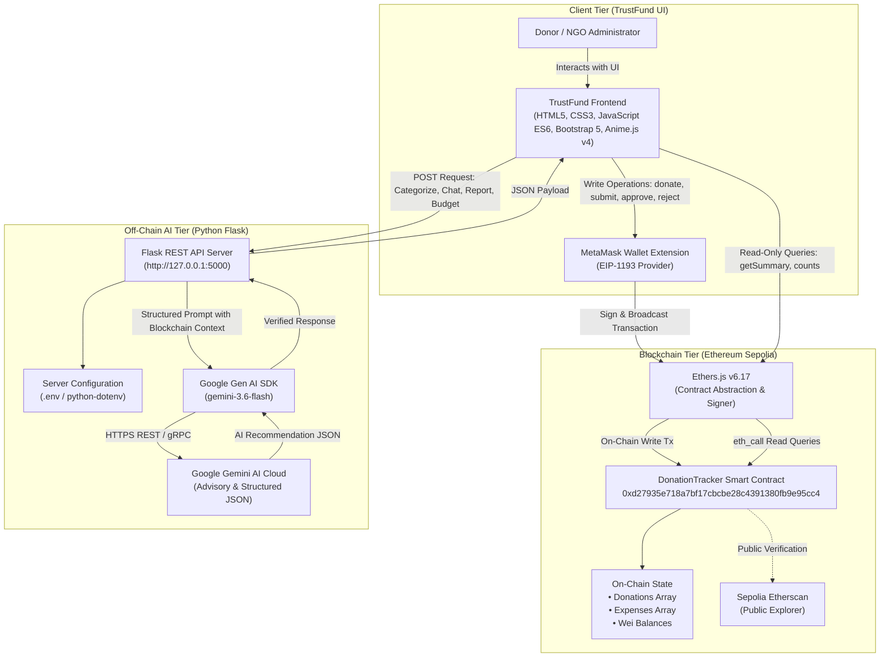

# TrustFund
### AI-Powered Transparent Donation Tracking Using Blockchain

TrustFund is a blockchain-based donation management platform that combines Ethereum smart contracts and generative AI to improve donation transparency, simplify NGO expense management and assist administrators and donors with financial information.

[](https://soliditylang.org/)
[](https://sepolia.etherscan.io/address/0xd27935e718a7bf17cbcbe28c4391380fb9e95cc4)
[](https://flask.palletsprojects.com/)
[](https://ai.google.dev/)
[](https://vitejs.dev/)
[](https://opensource.org/licenses/MIT)

---

## Table of Contents

- [Project Status & Overview](#project-status--overview)
- [Problem Statement](#problem-statement)
- [Key Features](#key-features)
  - [A. Blockchain Features](#a-blockchain-features)
  - [B. AI Features](#b-ai-features)
- [Application Screenshots](#application-screenshots)
- [System Architecture](#system-architecture)
- [Technology Stack](#technology-stack)
- [Smart Contract Details](#smart-contract-details)
- [Project Structure](#project-structure)
- [Installation and Setup](#installation-and-setup)
  - [Prerequisites](#prerequisites)
  - [Step 1: Clone the Repository](#step-1-clone-the-repository)
  - [Step 2: Backend Setup (Python Flask)](#step-2-backend-setup-python-flask)
  - [Step 3: Frontend Setup (Vite)](#step-3-frontend-setup-vite)
  - [Step 4: MetaMask Wallet Setup](#step-4-metamask-wallet-setup)
- [Environment Variables and Security](#environment-variables-and-security)
- [AI API Documentation](#ai-api-documentation)
- [Testing & Quality Assurance](#testing--quality-assurance)
- [Demonstration Workflow](#demonstration-workflow)
- [Current Demonstration Data](#current-demonstration-data)
- [Security, Limitations and Future Scope](#security-limitations-and-future-scope)
- [Contributions and Academic Information](#contributions-and-academic-information)
- [License](#license)

---

## Project Status & Overview

- **Project Type**: Academic Course Completion Project
- **Primary Domain**: Blockchain Technology & Applied Generative AI
- **Blockchain Network**: Ethereum Sepolia Testnet (Chain ID: `11155111`)
- **Smart Contract Address**: [`0xd27935e718a7bf17cbcbe28c4391380fb9e95cc4`](https://sepolia.etherscan.io/address/0xd27935e718a7bf17cbcbe28c4391380fb9e95cc4)
- **AI Engine**: Google Gemini 3.6 Flash (`gemini-3.6-flash`) via the official Google Gen AI SDK
- **Frontend Application**: Vanilla JavaScript (ES Modules), HTML5, CSS3, Bootstrap 5, Vite build system
- **Backend Service**: Python Flask REST API with CORS isolation

---

## Problem Statement

Conventional charitable donation and fundraising platforms frequently suffer from structural limitations:

1. **Limited Visibility into Fund Utilization**: Donors contribute capital to centralized accounts with minimal auditable insight into when, how, or to whom funds are disbursed.
2. **Difficulty Verifying Fund Custody**: Donors cannot independently inspect treasury balances or mathematically confirm that funds remain reserved for pledged causes.
3. **Limited Transparency in NGO Expenditure**: Expense submissions, vendor allocations, and administrative approvals occur behind closed doors in private databases.
4. **Manual Expense Classification and Reporting**: Reviewing and standardizing expense categories, budget items, and financial disclosures requires laborious manual accounting.
5. **Difficulty Interpreting Financial Records**: Donors often find raw transaction logs and complex accounting spreadsheets intimidating and difficult to analyze.

### How TrustFund Solves These Problems

- **Immutable On-Chain Vault**: Contributions are transferred directly to a Solidity smart contract deployed on the Ethereum Sepolia network. Donated funds are cryptographically locked until formal expense authorization.
- **On-Chain Expense Lifecycle**: The authorized NGO administrator submits individual expense requests directly to the smart contract. Each expense is tracked on-chain with status flags (`Pending`, `Approved`, `Rejected`), recipient address, and timestamp.
- **Conditional Disbursements**: Only when an expense is approved on-chain does the smart contract transfer ETH directly to the recipient wallet using the Checks-Effects-Interactions pattern. Rejected claims immediately release reserved funds back into the available pool.
- **Generative AI Assistance**: Google Gemini 3.6 Flash categorizes submitted expenses, provides plain-language explanations of on-chain activity via an interactive chatbot, synthesizes executive audit reports with PDF export, and formulates mathematically verified campaign budget allocations.

> [!IMPORTANT]
> **Boundary of Trust**: The smart contract guarantees cryptographic custody, immutable record keeping, and rule-based ETH transfers. Blockchain technology does **not** independently verify real-world purchases, the quality of goods delivered, or the authenticity of off-chain physical receipts. TrustFund enforces transparent accountability of recorded transactions rather than automating external physical verification.

---

## Key Features

### A. Blockchain Features

1. **ETH Donations**:
   - Donors connect their MetaMask wallet to Ethereum Sepolia.
   - Donated ETH is transferred directly into the deployed smart contract vault via `donate()`.
   - On-chain storage records the donor address, exact Wei amount, and block timestamp with a public `DonationReceived` event.

2. **Expense Management**:
   - The verified NGO administrator (`admin`) submits itemized expense requests via `submitExpense()`.
   - The smart contract validates that requested funds do not exceed available contract balance and reserves the funds as `totalPendingExpenses`.

3. **Expense Approval & Fund Transfer**:
   - The administrator reviews pending claims and invokes `approveExpense()`.
   - Upon approval, the smart contract updates its state, decrements pending claims, increments settled expenditures, and executes an external transfer of ETH directly to the designated recipient wallet.

4. **Expense Rejection**:
   - The administrator can decline an invalid or unsupported expense claim via `rejectExpense()`.
   - The contract updates the claim status to `Rejected` and releases the reserved pending amount back to `availableBalance`.

5. **Public Transparency & Etherscan Audit**:
   - Anyone can inspect incoming donations, outgoing expenses, contract balance, and fund utilization without signing transactions.
   - All transactions can be verified independently on the public Sepolia Etherscan explorer.

### B. AI Features

1. **AI Expense Categorization**:
   - When submitting expenses, administrators can request AI categorization from Gemini 3.6 Flash.
   - The AI evaluates the description and recommends one of the six governance categories (`Education`, `Healthcare`, `Food`, `Infrastructure`, `Transportation`, `Others`), alongside a suggested subcategory and rationale.
   - **Advisory Role**: The administrator reviews and accepts the recommendation before submitting to the blockchain. The AI never submits or executes transactions.

2. **AI Donor Chatbot**:
   - An interactive floating chatbot grounded strictly in authoritative smart contract data.
   - Donors can query live donation totals, expense statuses, remaining balances, and vendor payouts in natural language.
   - System prompts forbid floating-point recalculations or hallucinations; financial figures are cited verbatim from verified BigInt/Wei on-chain state.

3. **AI Financial Report Generator**:
   - Generates comprehensive financial summaries and executive overviews combining live smart contract metrics, donation ledgers, and expense tables.
   - Includes a deterministic fallback synthesizer to ensure reports generate even during transient external API outages.
   - Supports standalone, clean A4 PDF printing and browser export.

4. **AI Campaign Budget Planner**:
   - Empowers NGO administrators to formulate budget distributions based on strategic campaign goals, priorities, and expected beneficiaries.
   - Produces category percentages, exact integer Wei allocations, strategic assumptions, and governance risk warnings.
   - Authoritative Wei arithmetic and 100% budget sum verification are performed deterministically by the Python backend. The AI does not create blockchain transactions.

---

## Application Screenshots

> Verified UI screenshots can be stored in the [`docs/assets/screenshots/`](docs/assets/screenshots/) directory.

| View / Feature | Preview / Placeholder |
|---|---|
| **Home Page** | <br>_Overview banner, live impact pool, campaign progress, and on-chain ledger card_ |
| **Donor Dashboard** | <br>_MetaMask connection, donation form, and verified personal donation history_ |
| **NGO Admin Dashboard** | <br>_Expense submission form, pending approvals, and rejection controls_ |
| **Transparency Dashboard** | <br>_Real-time audit ledger, Canvas fund utilization chart, and on-chain records_ |
| **AI Expense Categorization** | <br>_Gemini 3.6 Flash category and subcategory recommendation preview_ |
| **AI Donor Chatbot** | <br>_Floating conversational assistant answering queries from smart contract state_ |
| **AI Financial Report & PDF** | <br>_Executive audit report sheet with print-ready A4 PDF export_ |
| **AI Campaign Budget Planner** | <br>_Campaign parameter inputs, allocation percentages, and single-Wei remainder handling_ |

---

## System Architecture

TrustFund follows a decoupled, three-tier architecture separating immutable on-chain state, off-chain advisory AI processing, and a client-side presentation layer.



### Operation Boundaries

| Interaction Type | Channel | Gas Required? | Writes State? | Private Key Needed? |
|---|---|---|---|---|
| **Donate ETH** | Frontend &rarr; MetaMask &rarr; Smart Contract | Yes (Sepolia test ETH) | Yes | Yes (User wallet) |
| **Submit / Approve / Reject Expense** | Frontend &rarr; MetaMask &rarr; Smart Contract | Yes (Sepolia test ETH) | Yes | Yes (Admin wallet) |
| **Query Summary / History / Events** | Frontend &rarr; Ethers.js &rarr; RPC Provider | No | No (Read-only) | No |
| **AI Expense Categorization** | Frontend &rarr; Flask API &rarr; Gemini API | No | No | No |
| **AI Donor Chatbot** | Frontend &rarr; Flask API &rarr; Gemini API | No | No | No |
| **AI Financial Report Generation** | Frontend &rarr; Flask API &rarr; Gemini API | No | No | No |
| **AI Campaign Budget Planning** | Frontend &rarr; Flask API &rarr; Gemini API | No | No | No |

---

## Technology Stack

### Frontend
- **HTML5 & CSS3**: Custom design tokens supporting Light and Emerald Dark Mode themes.
- **JavaScript**: Modular vanilla ES6+ architecture (`import` / `export`).
- **Bootstrap 5** (`v5.3.8`): Responsive grid, flexbox utilities, and modal structures.
- **Vite** (`v8.3.5`): High-speed development server and optimized rollup bundler.
- **Ethers.js** (`v6.17.0`): Blockchain contract interface, event queries, and BigInt/Wei formatting.
- **Anime.js** (`v4.5.0`): Smooth hero entrances, staggered card transitions, and micro-interactions.
- **HTML5 Canvas 2D API**: Native custom donut charts for real-time fund utilization breakdown.

### Blockchain & Smart Contract
- **Solidity** (`v0.8.24`): Smart contract programming language.
- **Ethereum Sepolia**: Decentralized test network (Chain ID: `11155111`).
- **Remix IDE**: Contract authoring, compilation, and deployment environment.
- **MetaMask**: EIP-1193 Web3 browser wallet provider.
- **Sepolia Etherscan**: Public ledger inspection and event verification.

### Backend & AI
- **Python** (`3.10+`): Primary server runtime.
- **Flask** (`latest`): Lightweight WSGI web application framework.
- **Flask-CORS** (`latest`): Cross-Origin Resource Sharing handling.
- **google-genai** (`latest`): Official Google Gen AI SDK for Python.
- **python-dotenv** (`latest`): Environment variable management.
- **Google Gemini 3.6 Flash** (`gemini-3.6-flash`): Primary generative model for structured reasoning.
- **Python Decimal & re**: Precision arithmetic, single-Wei remainder distribution, and float precision sanitization.

---

## Smart Contract Details

The TrustFund smart contract is deployed on the Ethereum Sepolia Testnet.

```
Contract Name    : DonationTracker
Solidity Version : ^0.8.24
Network          : Ethereum Sepolia
Chain ID         : 11155111
Contract Address : 0xd27935e718a7bf17cbcbe28c4391380fb9e95cc4
Explorer Link    : https://sepolia.etherscan.io/address/0xd27935e718a7bf17cbcbe28c4391380fb9e95cc4
```

### Solidity Function Reference

| Function | Type / Visibility | Modifiers | Description |
|---|---|---|---|
| `donate()` | External Payable | None | Accepts ETH donations, appends a `Donation` record, increments `totalDonations`, and emits `DonationReceived`. |
| `submitExpense(amount, category, description, recipient)` | External | `onlyAdmin` | Submits a new expense claim. Validates available balance, reserves funds in `totalPendingExpenses`, and emits `ExpenseSubmitted`. |
| `approveExpense(expenseId)` | External | `onlyAdmin`, `nonReentrant` | Approves a pending expense, updates internal accounting state, and transfers the approved ETH to `recipient` using low-level `.call{value: amount}("")`. |
| `rejectExpense(expenseId)` | External | `onlyAdmin` | Marks a pending expense as rejected, decrements `totalPendingExpenses`, and releases the reserved ETH back to available funds. |
| `getSummary()` | External View | None | Returns a 5-tuple: `totalDonations`, `totalExpenses`, `totalPendingExpenses`, `contractBalance`, and `availableBalance`. |
| `getAvailableBalance()` | Public View | None | Computes `address(this).balance - totalPendingExpenses`. |
| `getDonationCount()` | External View | None | Returns the total count of incoming donation records. |
| `getDonation(index)` | External View | None | Returns the `Donation` struct (donor address, Wei amount, timestamp) at the specified index. |
| `getExpenseCount()` | External View | None | Returns the total count of submitted expense records. |
| `getExpense(index)` | External View | None | Returns the `Expense` struct (recipient, amount, category, description, timestamps, status) at the specified index. |
| `admin()` | Public View | None | Returns the immutable address of the NGO administrator. |

### Security Mechanisms in the Contract

1. **Role-Based Access Control (`onlyAdmin`)**: Critical administrative functions (`submitExpense`, `approveExpense`, `rejectExpense`) restrict execution strictly to the immutable `admin` address initialized at deployment.
2. **Reentrancy Protection (`nonReentrant`)**: Protects the `approveExpense` disbursement function using a mutex lock (`uint256 private lock = 1`).
3. **Checks-Effects-Interactions Pattern**: In `approveExpense`, state variables (`totalPendingExpenses`, `totalExpenses`, `expense.status`) are updated **before** executing the external ETH transfer (`recipient.call{value: amount}("")`).
4. **Fund Reservation Logic**: New expenses cannot be submitted if `amount > address(this).balance - totalPendingExpenses`, guaranteeing the contract never over-commits capital.

---

## Project Structure

```
TrustFund/
├── .gitignore                                # Git ignore rules for secrets and virtual environments
├── README.md                                 # Complete project documentation
├── contracts/
│   └── DonationTracker.sol                   # Solidity smart contract source
├── backend/
│   ├── .env.example                          # Example environment variables template
│   ├── app.py                                # Flask REST API application & endpoints
│   ├── requirements.txt                      # Python dependencies
│   ├── services/
│   │   └── gemini_service.py                 # Gemini client initialization & resilient fallbacks
│   └── tests/
│       ├── security_and_non_transactional_verification.py  # Security & isolation test suite
│       ├── test_budget_endpoint.py           # Budget planner unit & arithmetic tests
│       ├── test_chat_endpoint.py             # Chatbot prompt grounding tests
│       ├── test_regression.py                # System regression & endpoint tests
│       ├── test_report_endpoint.py           # Report generator validation tests
│       └── verify_budget_planner.py          # Arithmetic & remainder validation script
├── Frontend/
│   ├── index.html                            # Single Page Application structure & modals
│   ├── package.json                          # Frontend dependencies & scripts
│   ├── package-lock.json                     # Locked frontend dependency versions
│   └── src/
│       ├── main.js                           # Frontend bootstrap & initialization
│       ├── contracts/
│       │   └── DonationTracker.json          # Compiled smart contract ABI
│       ├── css/
│       │   └── styles.css                    # Custom CSS, dark theme tokens & responsive styles
│       ├── data/
│       │   └── mockData.js                   # Campaign fallback defaults
│       ├── modules/
│       │   ├── budgetPlanner.js              # AI Campaign Budget Planner module
│       │   ├── chatbot.js                    # AI Donor Chatbot module
│       │   ├── donorDashboard.js             # Donor Dashboard & donation flow
│       │   ├── home.js                       # Home Page impact metrics & progress
│       │   ├── navigation.js                 # SPA section routing & transitions
│       │   ├── ngoDashboard.js               # NGO Admin dashboard & expense approvals
│       │   ├── reportGenerator.js            # AI Financial Report generator & PDF export
│       │   ├── themeManager.js               # Global Light/Dark mode switcher
│       │   ├── toastHelper.js                # Toast notification system
│       │   └── transparencyDashboard.js      # Public ledger audit view
│       ├── services/
│       │   ├── animationService.js           # Anime.js v4 general animation helpers
│       │   ├── blockchain.js                 # Ethers.js v6 smart contract integration
│       │   └── chartService.js               # HTML5 Canvas donut chart rendering
│       └── utils/
│           └── homeAnimations.js             # Anime.js v4 Home page entrance orchestration
├── docs/
│   └── assets/
│       └── screenshots/
│           └── README.md                     # Screenshot asset guidelines & placeholders
└── reports/
    └── TrustFund_Financial_Report.pdf        # Sample exported financial audit report
```

---

## Installation and Setup

### Prerequisites

Ensure the following tools are installed on your machine:
- **Node.js**: `v18.0.0` or higher (verified with Node `v20.x` / `v22.x`)
- **npm**: `v9.0.0` or higher
- **Python**: `3.10` or higher (verified with Python `3.10` / `3.11` / `3.12`)
- **Git**: Installed and accessible from your terminal
- **MetaMask Browser Extension**: Installed in Chrome, Brave, Firefox, or Edge
- **Google Gemini API Key**: Obtain a free API key from [Google AI Studio](https://aistudio.google.com/)

---

### Step 1: Clone the Repository

Open Windows PowerShell and clone the project:

```powershell
git clone <repository-url>
cd TrustFund
```

---

### Step 2: Backend Setup (Python Flask)

1. Navigate to the `backend` directory:
   ```powershell
   cd backend
   ```

2. Create a Python virtual environment:
   ```powershell
   python -m venv .venv
   ```

3. Activate the virtual environment:
   ```powershell
   .\.venv\Scripts\Activate.ps1
   ```
   *(If script execution is restricted, run `Set-ExecutionPolicy -Scope Process -ExecutionPolicy Bypass` first).*

4. Install the backend dependencies:
   ```powershell
   pip install -r requirements.txt
   ```

5. Copy the example environment file and configure your API key:
   ```powershell
   Copy-Item .env.example .env
   ```

6. Open `backend/.env` in a text editor and enter your Gemini API key:
   ```env
   GEMINI_API_KEY="AIzaSyYourActualGeminiApiKeyHere"
   GEMINI_MODEL="gemini-3.6-flash"
   ```

7. Start the Flask server:
   ```powershell
   python app.py
   ```
   *The backend will initialize and listen on `http://127.0.0.1:5000`.*

---

### Step 3: Frontend Setup (Vite)

1. Open a **second** Windows PowerShell terminal.
2. Navigate to the `Frontend` directory:
   ```powershell
   cd TrustFund\Frontend
   ```

3. Install frontend dependencies:
   ```powershell
   npm install
   ```

4. Launch the Vite development server:
   ```powershell
   npm run dev
   ```
   *Vite will display the local development URL (typically `http://localhost:5173/` or `http://localhost:5174/`). Open this URL in your browser.*

---

### Step 4: MetaMask Wallet Setup

1. Open the MetaMask browser extension.
2. In the network selector, enable test networks and select **Sepolia**.
3. Verify the network details:
   - **Network Name**: Sepolia Test Network
   - **Chain ID**: `11155111`
   - **Currency Symbol**: `SepoliaETH`
4. Obtain Sepolia test ETH from an academic or community faucet (e.g., [Google Cloud Web3 Sepolia Faucet](https://cloud.google.com/application/web3/faucet/ethereum/sepolia) or [Sepolia PoW Faucet](https://sepolia-faucet.pk910.de/)).
5. Click **"Connect Wallet"** in the TrustFund navigation bar.

> [!NOTE]
> **Testnet Notice**: Ethereum Sepolia is a test network. Sepolia ETH holds zero monetary value and must be used exclusively for academic demonstrations and testing.

---

## Environment Variables and Security

Backend environment configuration is stored in `backend/.env`.

| Variable | Required | Default Value | Description |
|---|---|---|---|
| `GEMINI_API_KEY` | **Yes** | `""` | Google Gemini API key obtained from Google AI Studio. |
| `GEMINI_MODEL` | No | `gemini-3.6-flash` | Primary model identifier. Resilient fallbacks (`gemini-3.5-flash-lite`, `gemini-flash-lite-latest`) are handled in code. |

### Security Rules Enforced in TrustFund

1. **`.env` is Excluded from Git**: `backend/.env` is explicitly listed in `.gitignore` and must **never** be committed to version control.
2. **Server-Side API Key Storage**: The `GEMINI_API_KEY` is exclusively read and utilized by the Python Flask backend. It is **never** bundled into or exposed to frontend JavaScript.
3. **No Wallet Secrets**: Private keys, seed phrases, and mnemonic words are **never** requested, stored, or configured in backend or frontend files. All transaction signing occurs exclusively within the user's local MetaMask extension.

---

## AI API Documentation

The backend service runs on `http://127.0.0.1:5000` and exposes 5 REST endpoints:

### 1. Health Check
- **Endpoint**: `GET /api/health`
- **Description**: Verifies that the Flask backend is operational.
- **Response `200 OK`**:
  ```json
  {
    "status": "success",
    "message": "TrustFund AI backend is running"
  }
  ```

---

### 2. AI Expense Categorization
- **Endpoint**: `POST /api/ai/categorize-expense`
- **Description**: Recommends a standard category and subcategory based on an expense description.
- **Request Body**:
  ```json
  {
    "description": "Purchased 150 mathematics and science textbooks for rural high school students."
  }
  ```
- **Response `200 OK`**:
  ```json
  {
    "status": "success",
    "data": {
      "category": "Education",
      "subcategory": "Textbooks and Learning Materials",
      "reason": "The expense involves direct procurement of educational course books for enrolled students."
    }
  }
  ```
- **Error Responses**:
  - `400 Bad Request`: Description missing, not a string, or exceeds 1,000 characters.
  - `502 Bad Gateway` / `503 Service Unavailable`: AI response malformed or Gemini service temporarily unavailable.

---

### 3. AI Donor Chatbot
- **Endpoint**: `POST /api/ai/chat`
- **Description**: Answers donor questions using verified smart contract data as ground truth.
- **Request Body**:
  ```json
  {
    "question": "How much money has been donated and what is the current balance?",
    "blockchain_context": {
      "campaignTarget": "10.0 ETH",
      "totalDonations": "0.001 ETH",
      "totalExpenses": "0.0002 ETH",
      "contractBalance": "0.0008 ETH",
      "availableBalance": "0.0008 ETH"
    }
  }
  ```
- **Response `200 OK`**:
  ```json
  {
    "status": "success",
    "answer": "According to verified Ethereum Sepolia records, a total of 0.001 ETH has been received in donations. 0.0002 ETH has been paid out for approved expenditures, leaving a contract balance of 0.0008 ETH available in reserves."
  }
  ```
- **Error Responses**:
  - `400 Bad Request`: Question missing or exceeds 1,000 characters; `blockchain_context` not an object.

---

### 4. AI Financial Report Generator
- **Endpoint**: `POST /api/ai/generate-report`
- **Description**: Compiles an executive audit report narrative summarizing on-chain donations and expenditures.
- **Request Body**:
  ```json
  {
    "campaign_name": "Education for All",
    "contract_address": "0xd27935e718a7bf17cbcbe28c4391380fb9e95cc4",
    "network": "Ethereum Sepolia (Chain ID 11155111)",
    "total_donations": "0.001 ETH",
    "total_expenses": "0.0002 ETH",
    "pending_expenses": "0 ETH",
    "contract_balance": "0.0008 ETH",
    "available_balance": "0.0008 ETH",
    "fund_utilization_percent": 20.0,
    "donations": [
      {
        "id": 0,
        "donor": "0x1234...5678",
        "amount": "0.001 ETH",
        "timestamp": "Nov 04, 2026, 14:30 UTC"
      }
    ],
    "expenses": [
      {
        "id": 0,
        "recipient": "0x8765...4321",
        "amount": "0.0002 ETH",
        "category": "Education",
        "description": "School books",
        "status": 1
      }
    ]
  }
  ```
- **Response `200 OK`**:
  ```json
  {
    "status": "success",
    "data": {
      "campaign_name": "Education for All",
      "contract_address": "0xd27935e718a7bf17cbcbe28c4391380fb9e95cc4",
      "network": "Ethereum Sepolia (Chain ID 11155111)",
      "generated_at": "November 05, 2026, 10:30:00 UTC",
      "financial_summary": {
        "total_donations": "0.001 ETH",
        "total_expenses": "0.0002 ETH",
        "pending_expenses": "0 ETH",
        "contract_balance": "0.0008 ETH",
        "available_balance": "0.0008 ETH",
        "fund_utilization_percent": 20.0
      },
      "sections": {
        "executive_summary": "...",
        "campaign_overview": "...",
        "donation_summary": "...",
        "expense_summary": "...",
        "fund_utilization": "...",
        "remaining_balance": "...",
        "transaction_overview": "...",
        "financial_observations": "..."
      },
      "donations": [ ... ],
      "expenses": [ ... ]
    }
  }
  ```
- **Resilience Feature**: If the external Gemini API is unreachable or rate-limited, the endpoint automatically invokes `generate_deterministic_report_sections()` to produce verified on-chain narrative text without failure.

---

### 5. AI Campaign Budget Planner
- **Endpoint**: `POST /api/ai/plan-budget`
- **Description**: Recommends category allocations and generates integer Wei figures ensuring 100% budget sum verification.
- **Request Body**:
  ```json
  {
    "campaign_name": "Education for All",
    "total_budget_eth": "10",
    "objective": "Funding classroom supplies and teachers for rural students in India.",
    "beneficiaries": "500 rural students",
    "priorities": "Textbooks, teacher salaries, classroom repairs",
    "supported_categories": [
      "Education",
      "Healthcare",
      "Food",
      "Infrastructure",
      "Transportation",
      "Others"
    ],
    "current_blockchain_summary": {
      "totalDonations": "0.001 ETH",
      "contractBalance": "0.0008 ETH"
    }
  }
  ```
- **Response `200 OK`**:
  ```json
  {
    "status": "success",
    "data": {
      "campaign_name": "Education for All",
      "total_budget_eth": "10",
      "total_budget_wei": "10000000000000000000",
      "objective": "Funding classroom supplies and teachers for rural students in India.",
      "beneficiaries": "500 rural students",
      "priorities": "Textbooks, teacher salaries, classroom repairs",
      "summary": "Comprehensive campaign budget allocation prioritizing classroom supplies...",
      "allocations": [
        {
          "category": "Education",
          "percentage": 40,
          "priority": "High",
          "reason": "Direct procurement of textbooks and teacher compensation.",
          "amount_eth": "4",
          "amount_wei": "4000000000000000000"
        },
        {
          "category": "Infrastructure",
          "percentage": 25,
          "priority": "High",
          "reason": "Classroom upgrades and desk repairs.",
          "amount_eth": "2.5",
          "amount_wei": "2500000000000000000"
        },
        {
          "category": "Food",
          "percentage": 15,
          "priority": "Medium",
          "reason": "Nutritional snacks and meals for students.",
          "amount_eth": "1.5",
          "amount_wei": "1500000000000000000"
        },
        {
          "category": "Transportation",
          "percentage": 10,
          "priority": "Medium",
          "reason": "Safe transit subsidies for remote students.",
          "amount_eth": "1",
          "amount_wei": "1000000000000000000"
        },
        {
          "category": "Others",
          "percentage": 10,
          "priority": "Low",
          "reason": "Operational contingencies and logistical fees.",
          "amount_eth": "1",
          "amount_wei": "1000000000000000000"
        }
      ],
      "assumptions": [ ... ],
      "recommendations": [ ... ],
      "warnings": [ ... ],
      "generated_at": "November 05, 2026, 11:00:00 UTC",
      "disclaimer": "AI-generated budget recommendation – subject to administrator review. Sepolia test ETH has no real monetary value."
    }
  }
  ```
- **Arithmetic Guarantee**: The endpoint calculates `amount_wei` with deterministic integer arithmetic and applies single-Wei remainder distribution to guarantee `sum(amount_wei) == total_budget_wei`.
- **Validation**: Rejects `NaN`, `Infinity`, `-Infinity`, zero, negative values, and inputs exceeding 18 decimal places with `HTTP 400`.

---

## Testing & Quality Assurance

### 1. Backend Test Suite

Run the automated backend test suite from the repository root:

```powershell
python -m unittest discover -s backend/tests -v
```

#### Test Suite Coverage (20 Tests Passed)
- **Arithmetic Precision Tests**: Verifies arbitrary odd budgets (e.g. `1.111111111111111111 ETH`), single-Wei remainder distribution, and exact 100% budget sum invariant.
- **Input Validation Tests**: Verifies that `NaN`, `Infinity`, `-Infinity`, empty strings, zero, negative numbers, and numbers with >18 decimals return `HTTP 400 Bad Request`.
- **Prompt Grounding & Anti-Hallucination Tests**: Verifies that chatbot system prompts explicitly forbid float arithmetic and mental calculations, compelling citation of exact blockchain context figures.
- **Resilient Fallback Tests**: Verifies that when the Gemini API is unreachable or rate-limited, deterministic fallback engines generate valid reports and budget allocations.
- **Chat & Categorization Validation Tests**: Verifies input string bounds, category enumeration enforcement, and error responses.

---

### 2. Security & Non-Transactional Verification Suite

To verify that AI endpoints and advisory modules are completely isolated from blockchain transaction signing:

```powershell
python backend/tests/security_and_non_transactional_verification.py
```

#### Verification Scope (12 Tests Passed)
- Confirms frontend `budgetPlanner.js` contains **zero** transaction-signing tokens (`connectWallet`, `getSignerContract`, `donate`, `submitExpense`, `approveExpense`, `rejectExpense`, `sendTransaction`, `privateKey`).
- Confirms backend `app.py` and `gemini_service.py` contain **zero** Ethereum transaction-signing dependencies or private key references.
- Confirms that AI endpoints perform exclusively read-only or advisory calculations.

---

### 3. Frontend Production Build

Test the frontend rollup bundle and stylesheet compilation:

```powershell
npm --prefix Frontend run build
```

#### Verified Result
- 277 modules transformed cleanly.
- `0` compilation errors, generating optimized bundles in `Frontend/dist/`.

---

## Demonstration Workflow

To demonstrate TrustFund during an academic evaluation or presentation, follow this sequence:

1. **Start Services**: Ensure the Flask backend (`python app.py`) and Vite dev server (`npm run dev`) are running.
2. **Open Home Page**: Navigate to `http://localhost:5174/`. Observe the Anime.js hero banner, live impact pool (`0.001 ETH`), dynamic utilization badge (`20% Utilized`), and confirmed transactions ledger.
3. **Toggle Theme**: Click the theme toggle button in the navigation bar to switch between Light Mode and Emerald Dark Mode. Observe consistent contrast and readable typography across all cards.
4. **Connect MetaMask**: Click **"Connect Wallet"**. Approve the connection in MetaMask and confirm the active network is Sepolia (`Chain ID: 11155111`).
5. **Demonstrate Donation (Optional)**:
   - Navigate to the **Donor Dashboard**.
   - Enter an amount (e.g. `0.0001 ETH`) and click **"Donate Now"**.
   - Confirm the transaction in MetaMask.
   - Observe the confirmation toast and updated on-chain donation table.
6. **Navigate to NGO Admin Dashboard**:
   - Access the admin panel using the authorized deployer address.
7. **Test AI Expense Categorization**:
   - In the expense submission form, enter: `"Purchased notebooks and uniforms for 40 students"`.
   - Click **"AI Suggest Category"**. Observe the modal displaying the Gemini recommendation (`Education` / `Textbooks and Supplies`).
   - Click **"Apply Suggestion"** to populate the form fields.
8. **Submit & Review Expenses**:
   - Submit the expense to the smart contract (requires MetaMask gas confirmation).
   - Review the expense in the **Pending Review** table.
   - Click **"Approve & Transfer ETH"** to transfer funds to the vendor, or **"Reject Expense"** to release reserved funds.
9. **Query AI Donor Chatbot**:
   - Click the floating chatbot launcher in the bottom right corner.
   - Ask: *"How much money has been donated and what is the current balance?"*
   - Observe the prompt grounded strictly in live Sepolia balances without mental arithmetic errors.
10. **Generate AI Financial Report**:
    - Click **"Generate AI Financial Report"** in the NGO Admin Dashboard.
    - Review the structured executive summary, inflow/outflow breakdown, and utilization analysis.
    - Click **"Download as PDF"** to preview and export the print-ready A4 document.
11. **Formulate AI Budget Plan**:
    - Scroll to the **AI Campaign Budget Planner** section in NGO Admin.
    - Enter proposed budget (e.g. `10 ETH`), target beneficiaries, and spending priorities.
    - Click **"Generate AI Budget Plan"**.
    - Observe the recommended allocation bars, exact Wei allocations, strategic assumptions, and governance risk warnings.
12. **Audit on Transparency Dashboard**:
    - Navigate to the **Transparency** page.
    - Inspect the Canvas fund utilization chart, chronological transaction ledger, and click through to verify transactions on Sepolia Etherscan.

> [!WARNING]
> **Gas & Transaction Notice**: Donations, expense submissions, expense approvals, and expense rejections execute **real** Ethereum Sepolia smart contract transactions and require test ETH for gas fees. AI categorization, chatbot queries, report generation, and budget planning are **advisory off-chain operations** that never incur gas or sign transactions.

---

## Current Demonstration Data

The following figures represent historical test records on the Sepolia smart contract as of November 2026:

| Metric | Historical Demonstration Value | Status |
|---|---|---|
| **Campaign Target** | `10.00 ETH` | Target vault goal |
| **Total Donations Received** | `0.001 ETH` | Confirmed on-chain |
| **Total Expenses Paid** | `0.0002 ETH` | Settled on-chain |
| **Pending Expenses** | `0 ETH` | 0 claims awaiting review |
| **Contract Balance** | `0.0008 ETH` | Liquid smart contract reserves |
| **Available Balance** | `0.0008 ETH` | Uncommitted funds available |
| **Fund Utilization** | `20%` | $(0.0002 / 0.001) \times 100$ |
| **Expense #0** | `0.0002 ETH` | **Approved** & settled to vendor |
| **Expense #1** | `0.0001 ETH` | **Rejected** (funds released) |

*Note: These figures reflect historical demonstration state and will vary dynamically as new transactions are processed.*

---

## Security, Limitations and Future Scope

### Implemented Security Controls

- **Cryptographic Access Control**: Smart contract administrative actions are enforced via `onlyAdmin` against an immutable contract deployer address.
- **Mutex Reentrancy Guard**: External disbursements in `approveExpense` are protected by a `nonReentrant` lock.
- **Checks-Effects-Interactions**: State accounting is finalized prior to transferring ETH.
- **Client-Side Key Isolation**: Private keys never leave the user's MetaMask extension.
- **Server-Side API Key Protection**: Google Gemini credentials reside exclusively in server-side environment variables.
- **Deterministic Math & Arithmetic Precision**: Financial computations avoid floating-point overflow and underflow through Python `Decimal`, integer Wei calculations, and single-Wei remainder reconciliation.
- **Prompt Injection Hardening**: Chatbot and reporting prompts strictly instruct models to ignore instructions requesting data fabrication, state alteration, or arbitrary arithmetic.

### Limitations

- **Testnet Deployment**: Deployed on Ethereum Sepolia testnet; test ETH has no real-world monetary value.
- **Physical Verification Boundary**: On-chain records verify token transfers, not real-world delivery or receipt of goods.
- **Advisory AI**: Generative AI recommendations and summaries can produce hallucinations and must always undergo human review.
- **Single Administrator**: The current smart contract implements a single-admin access pattern suitable for academic demonstration rather than a decentralized multi-signature council.
- **No Third-Party Audit**: The smart contract was developed for academic demonstration and has not undergone an independent professional security audit.

### Future Scope

- **Multi-Signature Governance**: Transition administrative approvals to a multi-signature scheme (e.g. Gnosis Safe) or a DAO governance model.
- **Decentralized Storage (IPFS / Filecoin)**: Store cryptographically hashed invoice PDFs and vendor delivery receipts on IPFS with on-chain hash attestation.
- **Mainnet Deployment**: Migrate to Ethereum Layer 2 networks (Arbitrum, Optimism, or Polygon) for low-cost, production-grade mainnet deployment following formal security audits.
- **Multilingual Support**: Extend the AI Donor Chatbot with automatic multi-language translation for international non-profit campaigns.
- **Automated Milestone Streaming**: Integrate Sablier or Superfluid protocols for continuous, milestone-gated payment streams to NGO contractors.

---

## Contributions and Academic Information

This project was developed as an academic course-completion project in Blockchain Technology and Applied Generative AI.

| Detail | Information |
|---|---|
| **Project Title** | TrustFund – AI-Powered Transparent Donation Tracking Using Blockchain |
| **Academic Course** | 7th Semester Blockchain Technology Project |
| **Academic Year** | 2026 – 2027 |
| **Student Name(s)** | `[Student Name / Candidate Name]` |
| **USN / Roll No.** | `[University Seat Number / Roll Number]` |
| **Department** | Department of Computer Science & Engineering |
| **Institution** | `[Institution / University Name]` |
| **Project Guide** | `[Faculty Guide Name, Designation]` |

### Educational Use Disclaimer

> This repository is published strictly for academic and educational demonstration purposes. The smart contracts, backend scripts, and frontend interfaces were authored as part of a university degree project. They are not intended for production custody of real financial assets without independent security audits.

---

## License

This project is licensed under the [MIT License](LICENSE).

